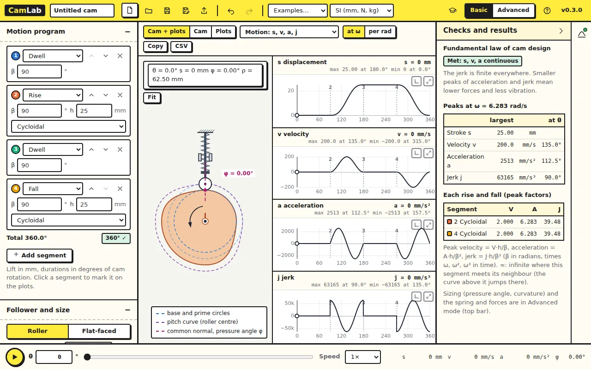
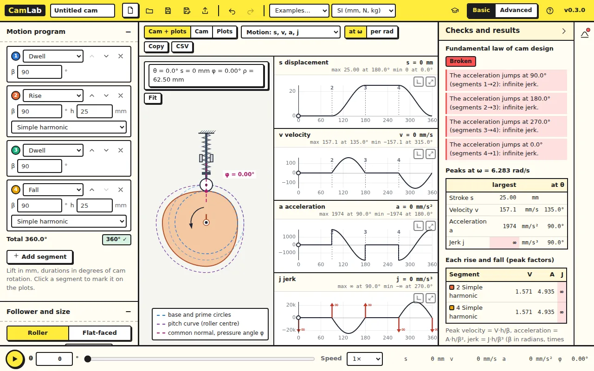

You will open a double-dwell cam, read its displacement, velocity,
acceleration and jerk (the SVAJ diagrams) and see why the choice of motion
law matters, using the fundamental law of cam design.

## 1. Open CamLab

Open [CamLab](../camlab/) and click **New** in the top bar. Check that the
units, beside **Examples…**, are *SI (mm, N, kg)*.

## 2. Read the motion program

A new design is a double-dwell cam. The **Motion program** on the left lists
its four segments, in degrees of cam rotation:

| Segment | What the follower does |
|---|---|
| 1 **Dwell**, 90° | stays down |
| 2 **Rise**, 90°, h = 25 mm, **Cycloidal** | rises 25 mm |
| 3 **Dwell**, 90° | stays up |
| 4 **Fall**, 90°, h = 25 mm, **Cycloidal** | comes back down |

The total must be 360°; the green tag under the list confirms it. The cam
turns at ω = 6.283 rad/s (60 rpm), under **Speed** in **Follower and size**.

## 3. Read the SVAJ diagrams

The four plots show s, v, a and j over one turn of the cam. The dotted lines
numbered 2, 3 and 4 are where each segment starts. Type an angle in the θ
box at the bottom, or drag the slider beside it, to turn the cam.

Under **Checks and results**, the **Fundamental law of cam design** says
*Met*: displacement, velocity and acceleration are continuous, so the jerk
is finite everywhere.

### Check your numbers

For a cycloidal rise the peaks are V = 2h/β, A = 2πh/β² and J = 4π²h/β³
(per radian of cam angle, with β in radians), times ω, ω² and ω³ for time.
With h = 25 mm, β = π/2 and ω = 2π rad/s:

| Peak | By hand | CamLab |
|---|---|---|
| Velocity | 2 · 25 / (π/2) · 2π | 200.0 mm/s |
| Acceleration | 2π · 25 / (π/2)² · (2π)² | 2513 mm/s² |
| Jerk | 4π² · 25 / (π/2)³ · (2π)³ | 63165 mm/s³ |

## 4. Change the motion law

In segment 2, change **Cycloidal** to **Simple harmonic**. Do the same in
segment 4.

The peak velocity and acceleration go down (157.1 mm/s and 1974 mm/s²), but
the fundamental law now reads **Broken**. The acceleration jumps where each
rise or fall meets a dwell, so the jerk is infinite there: the red arrows on
the jerk plot. A real cam would hit the follower at those points, four times
a turn.

This is the main lesson of cam design: a smaller peak is not better if the
motion is not smooth.

## Try this

Change segments 2 and 4 to **3-4-5 polynomial**. Is the fundamental law met?
How do the peaks compare with cycloidal motion?

Answer

The law is met: s, v and a are continuous. Peak velocity 187.5 mm/s and
acceleration 2309 mm/s² are lower than cycloidal (200.0 and 2513), but the
peak jerk is higher: 96000 mm/s³ against 63165. Both laws keep the jerk
finite. Choosing a law is a trade-off between these peaks.

