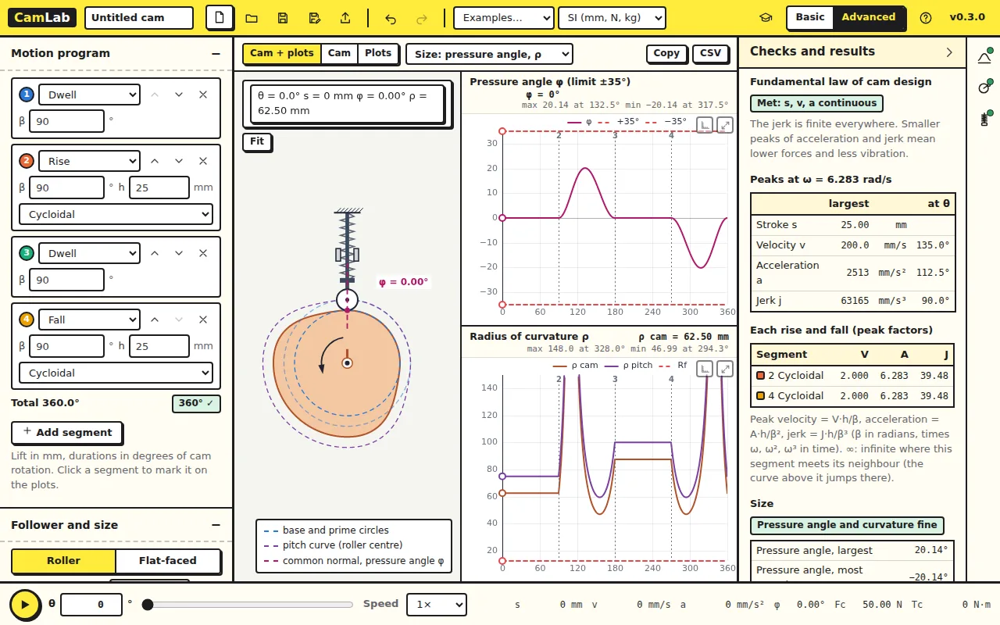
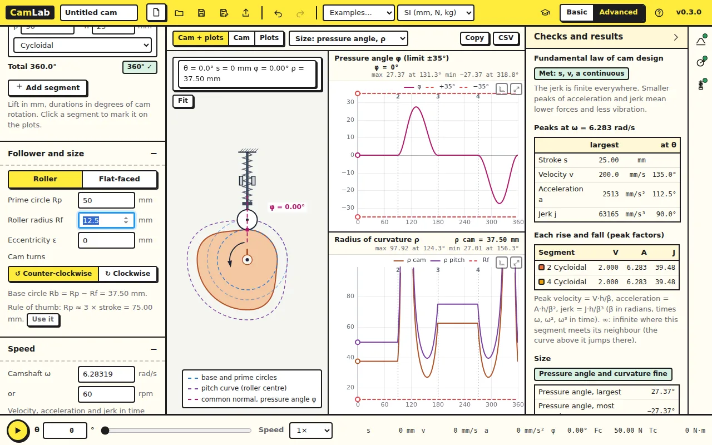
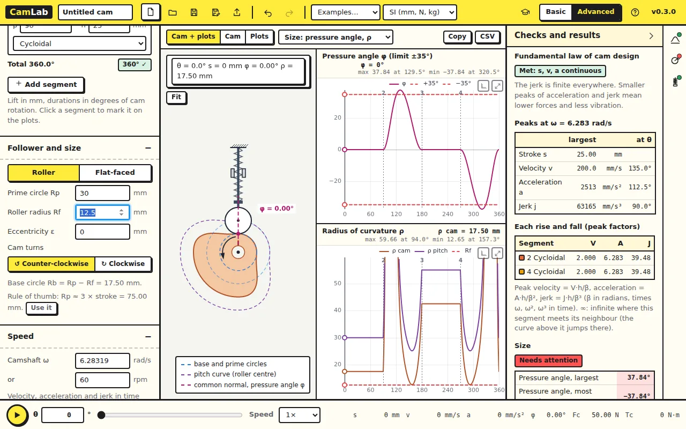

The motion program fixes how the follower moves. The size of the cam decides
whether it can deliver that motion smoothly. This lesson sets the prime
circle.

Open [CamLab](../camlab/), click **New** and switch to **Advanced**. Under
**Plots beside the cam** choose *Size: pressure angle, ρ*.

## 1. Two numbers to watch

**Pressure angle φ** is the angle between the force the cam applies and the
direction the follower moves. The larger it is, the more of the cam force
pushes the follower sideways against its guide. A common limit for a
translating follower is 30°.

**Radius of curvature ρ** of the pitch curve must stay larger than the
roller radius Rf on a convex part, or the roller cannot follow the cam and
the profile is undercut.

With the new design, Rp = 75 mm and Rf = 12.5 mm, **Size** under Checks
and results reads *Pressure angle and curvature fine*:

| Rp = 75 mm | CamLab |
|---|---|
| Pressure angle, largest | 20.14° |
| ρ min, pitch curve | 59.49 mm |
| ρ min, cam surface (ρ − Rf) | 46.99 mm |

### Check your numbers

For a radial roller follower, tan φ = (ds/dθ − ε) / (s + √(Rp² − ε²)),
with ε the eccentricity (zero here). The largest ds/dθ of a cycloidal rise is
2h/β = 31.8 mm/rad, at mid-rise where s = h/2 = 12.5 mm:
tan φ = 31.8 / 87.5, φ = 20.0°. CamLab's 20.14° comes from the exact
curve, where the peak is slightly off mid-rise.

## 2. A smaller cam

Set **Prime circle Rp** to 50 mm. The pressure angle rises to 27.37° and
the cam surface's smallest radius of curvature drops to 27.01 mm. Still
fine, but closer to the limits. The cam is 33% smaller.

Now 30 mm: the pressure angle is 37.8° and the check reads *Needs
attention*. Both plots show why: the pressure angle crosses 30° through
most of the rise and fall, and the surface radius has fallen to 12.65 mm,
hardly larger than the roller.

The rule of thumb in the panel, Rp ≈ 3 × stroke, gives 75 mm for this
25 mm lift. It is a starting point, not a law: check both numbers.

## Try this

Keep Rp = 30 mm and change the motion law of the rise and fall to
**Simple harmonic**. Does the pressure angle improve? Why?

Answer

Yes, a little: simple harmonic motion has a lower peak velocity
(πh/2β against 2h/β for cycloidal, 21% less), and the pressure angle
follows ds/dθ. But lesson 1 showed that simple harmonic breaks the
fundamental law between a rise and a dwell. The honest fix for a large
pressure angle is a larger cam, a longer rise (bigger β) or an offset
follower, not a worse motion law.

