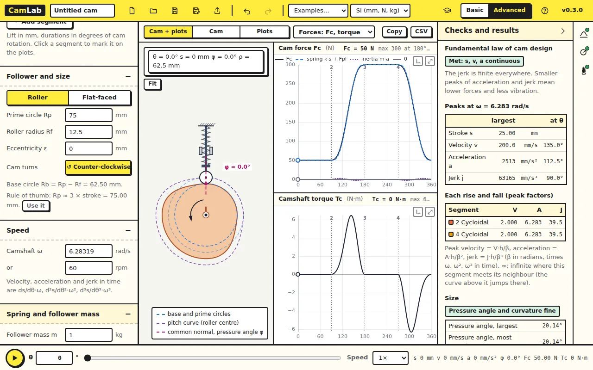
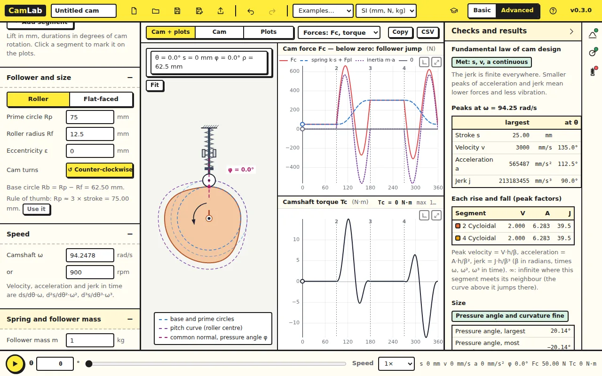

A cam can only push. A spring brings the follower back, and at speed the
follower's inertia fights the spring. This lesson finds the speed at which
the spring loses.

Open [CamLab](../camlab/), click **New**, switch to **Advanced**, open
**Spring and follower mass** on the left, and set **Plots beside the cam**
to *Forces: Fc, torque*.

## 1. The cam force

The new design has a follower mass m = 1 kg, a spring rate k = 10 N/mm, a
preload Fpl = 50 N and a damping ratio ζ = 0.06, at 60 rpm. The cam force
is Fc = m·a + c·v + k·s + Fpl, with a and v in time (the acceleration and
velocity per radian times ω² and ω).

| 60 rpm | CamLab |
|---|---|
| Damping c = 2ζ√(km) | 0.01200 N·s/mm |
| Natural frequency ωn | 100.0 rad/s |
| Cam force, largest | 300.0 N |
| Cam force, smallest | 50.00 N |
| Camshaft torque | −6.327 … 6.453 N·m |

At 60 rpm the inertia term is tiny: the force is the spring, 50 N at the
bottom and 50 + 10 × 25 = 300 N at the top. **Spring and forces** reads
*Follower stays on the cam*.

The torque plot goes negative on the fall: there the spring drives the cam.
Over a cycle the torque averages to zero (no friction), but the peaks size
the motor.

## 2. Faster

Set the speed to 600 rpm. The smallest cam force drops to 7.620 N, at
296°, early in the fall. There the follower is gathering speed downwards:
its acceleration is large and negative, so its inertia pulls it away from
the cam. Near the top of the rise (155.5°) the inertia pulls the same way,
yet the force stays at 36.13 N. The difference is the damping force c·v:
on the rise the cam also pushes against the damping (c·v adds to the
force); on the fall the damping helps pull the follower down (c·v takes
away from it).

At 900 rpm the smallest force is −309.4 N (at 294°; near the top of the
rise it is −270.6 N), and the check reads *Follower jump*. A negative cam
force is impossible: the cam cannot pull. The follower leaves the cam near
the top of the rise and again early in the fall, and lands again later
with an impact.

### Check your numbers

The peak negative acceleration of a cycloidal rise is −2πh/β² per rad²:
−63.7 mm/rad² here. At 900 rpm (ω = 94.2 rad/s) that is −565 m/s², so
m·a = −565 N against the spring's 50 + 10 × 25 = 300 N (less, since the
peak is not exactly at the top). Inertia wins.

## Try this

Still at 900 rpm, raise the **Preload** until the follower stays on. How
much is needed? What does it do to the largest cam force?

Answer

About 400 N: the smallest force is then 40.63 N. The price is the largest
force, now 1009 N instead of 659.4 N, on the cam, the roller and the shaft
bearings. The alternatives are a stiffer spring (same trade-off), a lighter
follower, or a slower cam: jump grows with ω².

