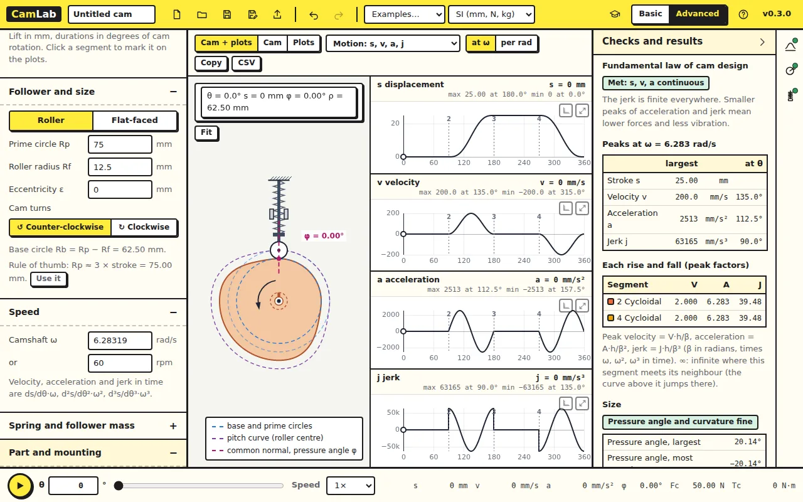
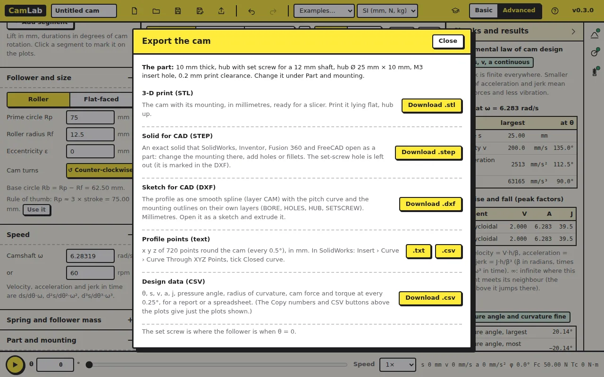

The last step is to make the cam. This lesson exports it in the formats a
printer and a CAD program take.

Open [CamLab](../camlab/), click **New** and switch to **Advanced**.

## 1. The part

Open **Part and mounting** on the left. **Thickness** and **Shaft Ø** set
the part; **How the cam fixes to its shaft** adds the mounting: a plain
bore, a keyway, a D-flat, a hub with a set screw or a bolt flange. Choose
*Hub with set screw*. The cam view shows the hub.

## 2. Export

Click **Export** in the top bar.

- **3-D print (STL)**: the cam with its mounting, in millimetres, for a
  slicer. Print it lying flat. The default **Print clearance** of 0.2 mm
  makes the bore a little larger than the shaft, as FDM printing needs.
- **Solid for CAD (STEP)**: an exact solid that SolidWorks, Inventor or
  Fusion 360 open as a part.
- **Sketch for CAD (DXF)**: the profile as one smooth spline on layer CAM,
  with the pitch curve and the mounting on their own layers. Open it as a
  sketch and extrude.
- **Profile points (text)**: x y z of 720 points round the cam, every 0.5°. In
  SolidWorks: Insert › Curve › Curve Through XYZ Points, ticking Closed
  curve.
- **Design data (CSV)**: θ, s, v, a, j, pressure angle, radius of
  curvature, cam force and torque every 0.25°, for a report.

### Check your numbers

In the profile points file, the first point is (0, 62.5, 0): the base
circle radius Rb = Rp − Rf = 75 − 12.5 = 62.5 mm, at the top of the
drawing. The furthest point is at 87.5 mm, Rb plus the 25 mm lift. The
mounting feature (here the set screw) marks where θ = 0 is on the printed
part.

## Try this

Export the STL and open it in your slicer. How long does the cam take to
print, and would a bolt flange change that?

Answer

It depends on your printer; a 10 mm thick cam of this size takes an hour
or two. A flange adds a thin disc and four holes, so little time. What
matters more for a working cam is the orientation (flat, so the profile is
drawn by the nozzle's path and not by layer steps) and the clearance of
the bore.

