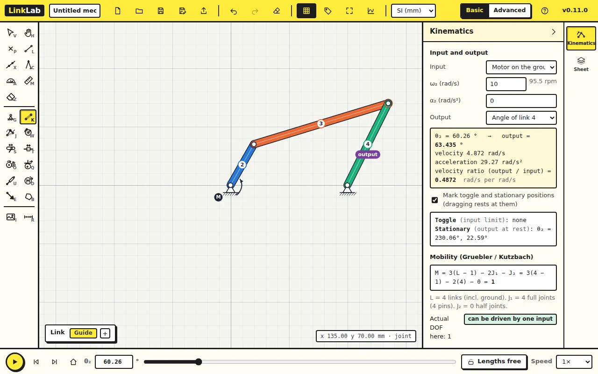
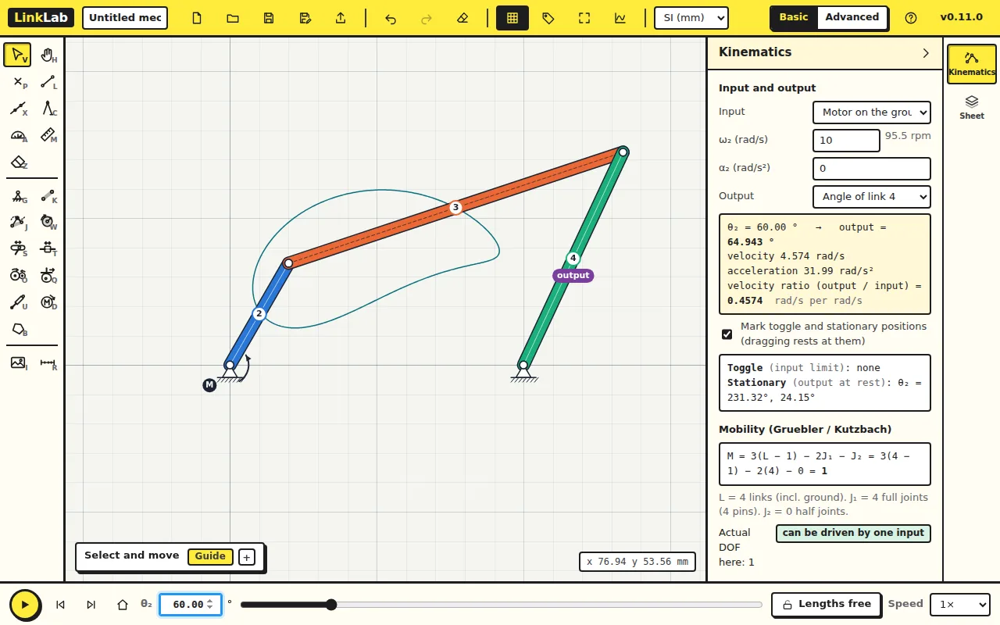
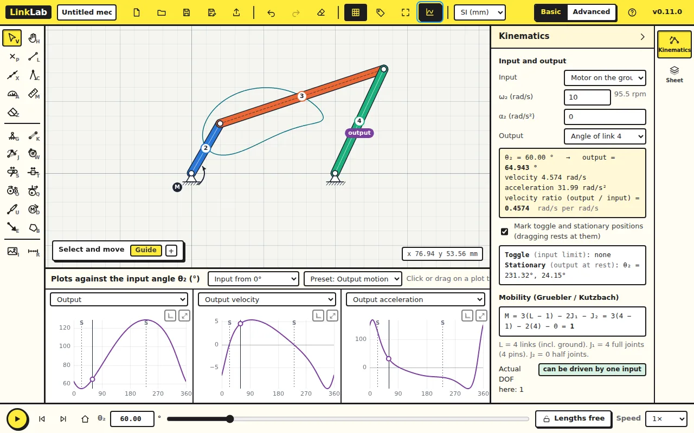

You will draw a fourbar linkage, set its link lengths exactly, run it with a
motor and read the rocker's angle, velocity and acceleration. These are the
same numbers you would get from the vector-loop equations by hand.

The mechanism: ground 100 mm, crank 40 mm, coupler 120 mm, rocker 80 mm.
The shortest link plus the longest (40 + 120 = 160) is less than the other
two (80 + 100 = 180), so by Grashof's rule the crank can turn all the way
round: a crank-rocker.

## 1. Open LinkLab

Open [LinkLab](../app/) in Chrome, Edge, Firefox or Safari. If something is
already drawn, click **New** in the top bar.

The first time you pick a tool, a short guide card shows the clicks. Read it
and close it with **Got it**.

## 2. Place the two ground pivots

Press <kbd>G</kbd> (the **Ground pivot** tool) and click twice on the sheet,
about 100 mm apart on a horizontal line. These are O₂ (left) and O₄ (right).

## 3. Draw the links

Press <kbd>K</kbd> (the **Link** tool).

1. Click the left pivot, then a point up and to the right of it (joint A),
   then a point further to the right (joint B). This draws the crank and the
   coupler. Press <kbd>Esc</kbd>.
2. Click the right pivot, then joint B. This draws the rocker. Press
   <kbd>Esc</kbd>.

The links are numbered 2, 3 and 4; the ground is link 1. A motor (**M**)
appears on the crank by itself: the first link drawn from a ground pivot
becomes the input.

Draw the rocker from its ground pivot, as above. LinkLab measures each link's
angle from the joint you clicked first, so the rocker's angle is then
measured from O₄, as θ₄ is in the vector-loop equations.

## 4. Make it exact

Press <kbd>V</kbd> (the **Select and move** tool). Click each joint and type
its **Position** in the Properties card, pressing <kbd>Tab</kbd> after each
number. Close the card with its × before clicking the next joint: the card
can cover it.

| Joint | x (mm) | y (mm) |
|---|---|---|
| J1, O₂ | 0 | 0 |
| J2, O₄ | 100 | 0 |
| J3, A | 20 | 34.641 |
| J4, B | 133.881 | 72.471 |

This is the mechanism at θ₂ = 60°. Click a link to check its **Length**:
40, 120 and 80 mm. Press <kbd>F</kbd> to fit the drawing in the window.

## 5. Watch it move

Click the round play button at the bottom left. The crank turns all the way
round and the rocker swings back and forth. The **Kinematics** panel says
"Toggle (input limit): none": nothing stops the crank, as Grashof's rule
predicted. Click the play button again to stop.

## 6. Trace a coupler curve

Press <kbd>J</kbd> (the **Point on link** tool) and click the middle of the
coupler. LinkLab draws the path of that point over a full turn of the crank:
its coupler curve. Points elsewhere on the coupler trace other curves; try a
few.

## 7. Read the numbers

In the **Kinematics** panel, check that the **Output** is *Angle of link 4*.
In the box beside θ₂ at the bottom, type 60 and press <kbd>Enter</kbd>.

The input turns at ω₂ = 10 rad/s with α₂ = 0, as set in the panel.

### Check your numbers

| At θ₂ = 60° | LinkLab |
|---|---|
| Rocker angle θ₄ | 64.943° |
| Rocker angular velocity ω₄ | 4.574 rad/s |
| Rocker angular acceleration α₄ | 31.99 rad/s² |

Work out θ₄ by hand with the vector-loop (Freudenstein) equation and compare.

## 8. Plot the whole cycle

Click **Plots** in the top bar. The three plots show the rocker's angle,
angular velocity and angular acceleration over a full turn of the crank.
Click or drag on a plot to move the mechanism to that angle. The rocker
swings between 54.90° and 128.68°; the marks **S** are where it stops and
turns back.

## Try this

Change ω₂ in the **Kinematics** panel from 10 to 20 rad/s (press
<kbd>Tab</kbd>). Before you look: what happens to ω₄ and α₄ at θ₂ = 60°?

Answer

ω₄ doubles to 9.147 rad/s and α₄ goes up four times, to 128 rad/s². With
α₂ = 0, velocities scale with ω₂ and accelerations with ω₂², because the
shape of the motion depends only on the geometry. The positions do not
change at all.

