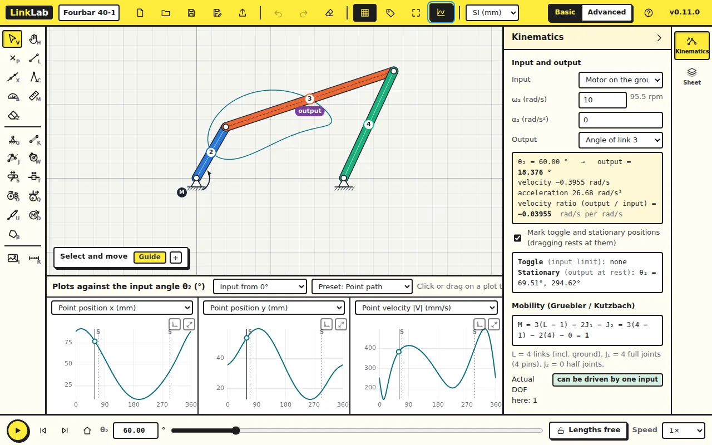

Lesson 1 gave the rocker's motion. This lesson reads the other links, follows
a point on the coupler, and checks where the mechanism works well.

Start from the fourbar of lesson 1 (40, 120, 80, 100 mm with a point in the
middle of the coupler), or download [fourbar.linklab.json](files/fourbar.linklab.json)
and open it with **Open** in the top bar.

## 1. Any link as the output

Set θ₂ to 60 in the box at the bottom. In the **Kinematics** panel, change
**Output** to *Angle of link 3*. The panel now reads the coupler.

| At θ₂ = 60°, ω₂ = 10 rad/s | LinkLab |
|---|---|
| θ₃ | 18.376° |
| ω₃ | −0.3956 rad/s |
| α₃ | 26.68 rad/s² |

The coupler's angle is measured from A to B, the order the link was drawn in.
Its angular velocity is negative here: the coupler is turning clockwise
while the crank turns counter-clockwise.

## 2. A point on the coupler

Click **Plots** and choose the preset **Point path**. The three plots give the
x and y of the traced point and its speed |V| over the cycle. Point at a plot
to read a value; click or drag on it to move the mechanism there.

### Check your numbers

At θ₂ = 60° the point P in the middle of the coupler moves at 382.6 mm/s.
By hand: V_P = V_A + ω₃ × r_PA, with V_A = aω₂ = 400 mm/s at 150° and
r_PA = 60 mm at 18.376°. Add the two vectors and compare.

## 3. Transmission angle

Choose the preset **Transmission**. The third plot is the transmission angle μ,
the angle between the coupler and the rocker. Force passes from the coupler
to the rocker best when μ is 90°, and poorly below about 40°.

Here μ is smallest at θ₂ = 0°: 26.4°. At that position the crank and the
coupler point almost the same way, and the rocker is pushed along its own
length rather than across it. This is the position to improve if the
mechanism has to carry a load.

## 4. Time and data

**Plot x-axis** switches the plots from the input angle to time over one
cycle, at the speed set in the panel. **Export data (CSV)** writes every
plotted quantity at every step, for a spreadsheet.

## Try this

Move the coupler point to a corner of the coupler (drag it with the
**Select and move** tool) and watch the coupler curve change. Which point
on the coupler has the smallest speed over the cycle?

Answer

There is no single answer; the point closest to the instant centre of the
coupler moves slowest at each moment, and that centre moves as the crank
turns. The point path plots let you compare candidates: the one with the
lowest peak in |V| is the slowest over the cycle.

