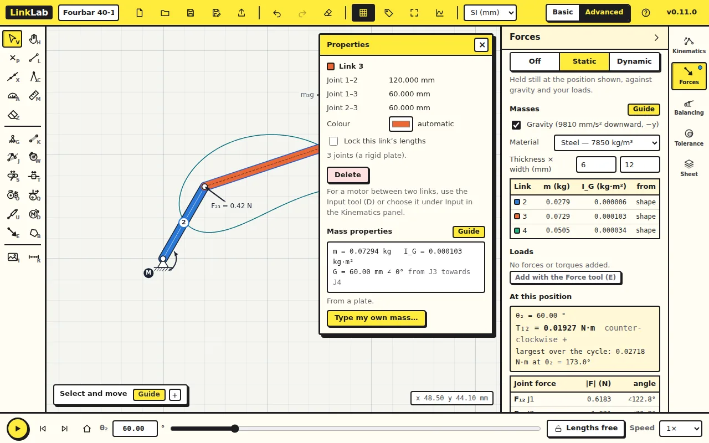
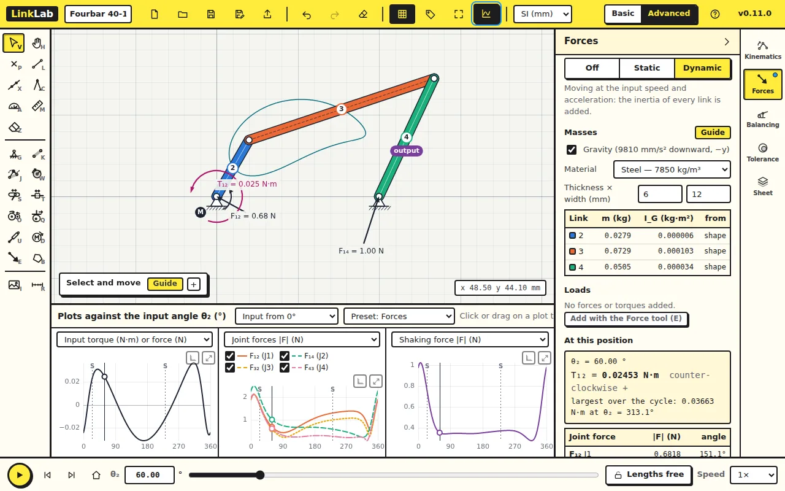

Kinematics tells you how the mechanism moves. This lesson asks what it
takes to move it: the force at each pin and the torque at the motor.

Start from [fourbar.linklab.json](files/fourbar.linklab.json) (lesson 1's
fourbar). Switch to **Advanced** in the top bar and open the **Forces**
tab. Set θ₂ to 60.

## 1. Held still

Click **Static**. LinkLab gives every link a mass from its shape: steel,
6 × 12 mm bars, and a plate for the coupler. The **Masses** table lists
m and I_G for each link. The motor holds the mechanism still against
gravity.

| At θ₂ = 60°, held still | LinkLab |
|---|---|
| Motor torque T₁₂ | 0.01927 N·m |
| F₁₂ (ground on crank, at J1) | 0.6183 N at 122.8° |
| F₁₄ (ground on rocker, at J2) | 1.021 N at 70.8° |

Click the coupler on the drawing. Its free-body diagram appears: the two
pin forces and its weight. They sum to zero, as they must for a link held
still. The same for the crank, with the motor torque added.

The name F₁₂ follows the usual textbook convention: the force of link 1 on
link 2. F₂₁ is the same force the other way round.

## 2. At speed

Click **Dynamic**. The input turns at ω₂ = 10 rad/s, and each link now has
an inertia force −m·a_G and an inertia couple −I·α as well.

| At θ₂ = 60°, ω₂ = 10 rad/s | LinkLab |
|---|---|
| Motor torque T₁₂ | 0.02453 N·m |
| Largest torque over the cycle | 0.03663 N·m at θ₂ = 313.1° |
| F₁₄ at J2 | 1.003 N at 72.0° |
| Largest joint force over the cycle | F₁₄ = 2.487 N at θ₂ = 8.9° |
| Shaking force on the frame | 0.351 N |

The **Largest over the cycle** table shows where each pin force peaks.
Click a row to go to that position.

Click **Plots** and choose the preset **Forces**: the motor torque, the joint
forces and the shaking force over the cycle.

### Check your numbers

Write the three equations of motion for each link (ΣF = m·a_G,
ΣM_G = I·α) with the accelerations from lesson 2, and solve the nine
equations for the eight pin-force components and T₁₂. The static case is the
same with every acceleration set to zero.

## Try this

In the **Kinematics** panel, set ω₂ to 30 rad/s (press <kbd>Tab</kbd>), then
look at the Forces tab again. How much does the largest motor torque grow?
Which pin now carries the largest force?

Answer

The largest torque goes from 0.0366 to 0.268 N·m, about 7.3 times, and the
largest pin force from 2.49 to 15.0 N, now F₁₂ at the crank pivot J1.
Inertia forces grow with ω², so tripling the speed would give nine times
the inertia forces; gravity, which does not grow, dilutes that a little.
At speed, the crank pivot takes the most.

