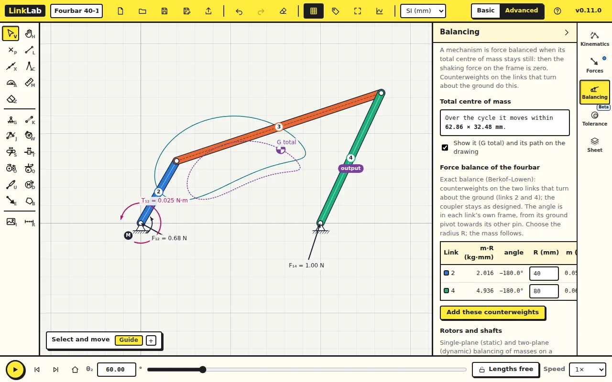
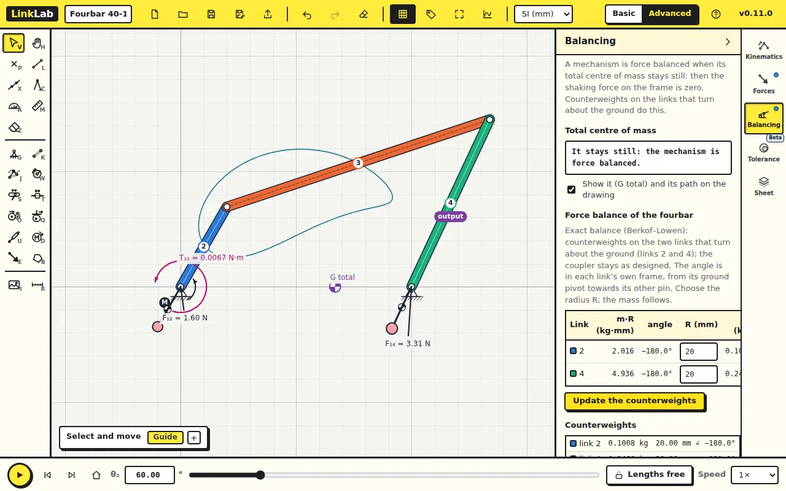
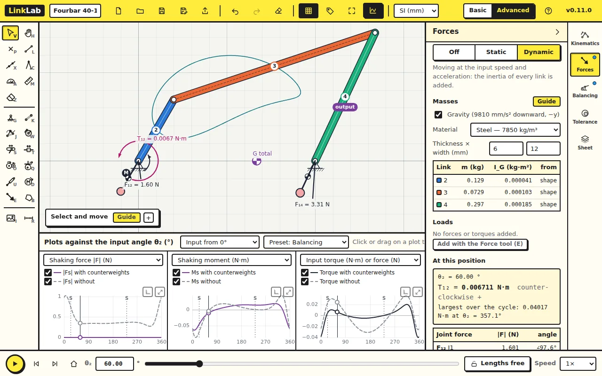

A mechanism shakes its frame when its total centre of mass moves. This
lesson stops that movement with two counterweights.

Start from [fourbar.linklab.json](files/fourbar.linklab.json). Switch to
**Advanced**, set the Forces tab to **Dynamic**, then open the
**Balancing** tab.

## 1. The total centre of mass

Tick **Show it (G total)**. A marker and its path appear on the drawing:
over the cycle, G total moves within 62.86 × 32.48 mm. The shaking force on
the frame is the total mass times the acceleration of this point.

## 2. The counterweights

The table under **Force balance of the fourbar** gives the counterweights
that hold G total still: on the crank and on the rocker, each measured in
the link's own frame from its ground pivot.

| Link | m·R | angle |
|---|---|---|
| 2 (crank) | 2.016 kg·mm | 180° |
| 4 (rocker) | 4.936 kg·mm | 180° |

Both sit directly opposite the link's other pin. Type a radius R of 20 mm
for each and the mass follows: 0.1008 kg on the crank and 0.2468 kg on the
rocker. Click **Add these counterweights**.

The panel now reads "It stays still: the mechanism is force balanced."

### Check your numbers

This is the Berkof–Lowen method. With the coupler's centre of mass at
distance b₃ from A along AB, the crank needs
m₂b₂e^(jφ₂) = m₃(a/b)(b₃e^(jφ₃) − b) in total, and the rocker
m₄b₄e^(jφ₄) = −m₃(c/b)b₃e^(jφ₃). Subtract what the bare links already
have (their own mass at mid-length) to get the counterweights above.

## 3. What balancing costs

The table **Without and with the counterweights** compares the two:

| Largest over the cycle | without | with |
|---|---|---|
| Shaking force | 1.022 N | 0 |
| Shaking moment | 0.0856 N·m | 0.0630 N·m |
| Motor torque | 0.0366 N·m | 0.0402 N·m |
| Joint force | 2.49 N | 4.53 N |

The shaking force is gone. The price is 10% more motor torque and 82%
more pin force, because the counterweights add mass that has to be
accelerated too. The shaking moment is reduced but not removed: force
balancing cannot do that.

The **Balancing** preset in the plots shows the shaking force, the shaking
moment and the motor torque over the cycle. Untick *Use the counterweights* to compare.

## Try this

Set R to 40 mm instead of 20 mm. What changes?

Answer

The masses halve (m·R stays the same: 0.0504 and 0.1234 kg) and the
mechanism is still balanced. The largest joint force comes down, from 4.53
to 3.83 N, because less mass is being swung round. But the largest motor
torque goes up, from 0.040 to 0.050 N·m: a mass further from the pivot has
more moment of inertia (m·R²), and the motor has to accelerate it. The
radius is a trade-off between pin load, torque and the room round the
pivot.

