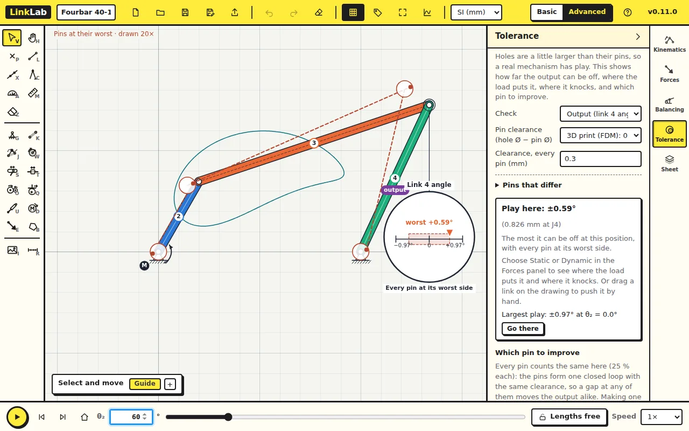
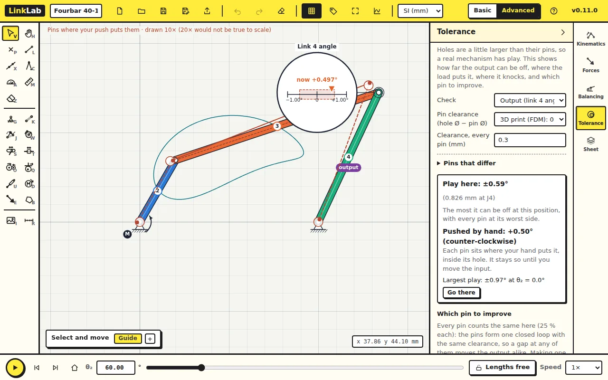
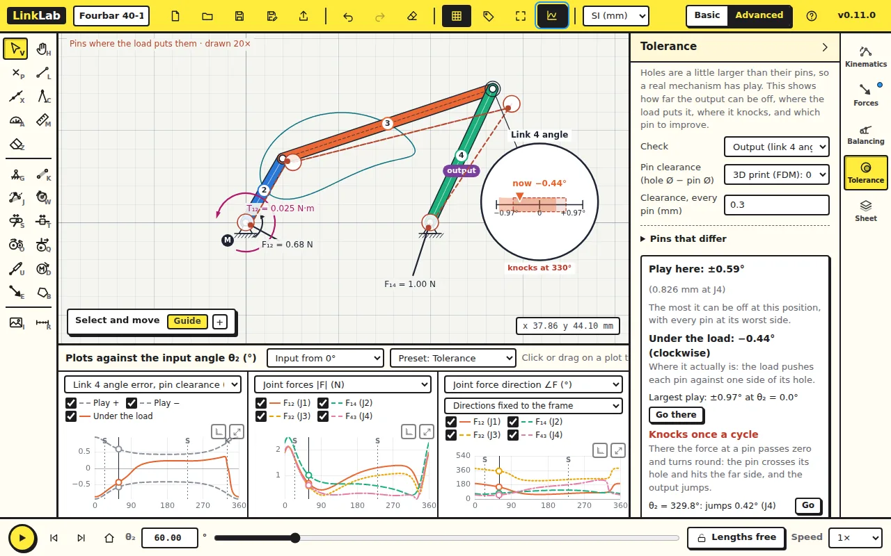

Real pins are smaller than their holes. This lesson shows what that does to
the rocker's angle, and which pin matters most.

The Tolerance tab is in beta: its numbers are estimates, good for comparing
designs and finding the pin to improve.

Start from [fourbar.linklab.json](files/fourbar.linklab.json). Switch to
**Advanced**, open the **Tolerance** tab and set θ₂ to 60.

## 1. The play

Under **Pin clearance**, choose *3D print (FDM): 0.300 mm*: each hole is
0.3 mm larger than its pin, so a pin can sit up to 0.15 mm off centre in
any direction. With **Check** on the output (link 4's angle), the panel
reads:

| Pin clearance 0.3 mm at all four pins | LinkLab |
|---|---|
| Play at θ₂ = 60° | ±0.59° |
| Largest play over the cycle | ±0.97° at θ₂ = 0° |

The play is largest at θ₂ = 0°, where the transmission angle is smallest
(lesson 2): the same geometry that passes force badly also passes error
well. The magnifier on the drawing shows the play here, ±0.59°, shaded on a
scale from −1° to +1°, and the dashed links show the mechanism with every
pin at its worst side, drawn larger.

### Check your numbers

Move each pin to the edge of its hole in turn, in every direction, solve the
fourbar with the shifted pins, and take the largest change in θ₄. Sampling
each pin at 24 directions (24⁴ cases) gives 0.592° at 60° and 0.969° at
0°.

## 2. Push it by hand

Drag the coupler on the drawing. The motor holds the crank, so the links
can only move within their play; the dashed drawing follows your hand, and
the panel reads **Pushed by hand** with the rocker's angle error. Push the
other way and the pins cross to the other side of their holes. This is the
backlash you would feel in the real mechanism.

## 3. Under the load

A running mechanism does not sit at random in its play: each pin is pushed
to one side of its hole by the force at that pin. In the **Forces** tab
choose **Dynamic**, then come back to Tolerance. **Under the load** gives
the actual error at this position, −0.44°, and the panel reports
**Knocks once a cycle**: at that position the force at a pin passes zero
and turns round, the pin crosses its hole, and the rocker jumps.

The preset **Tolerance** in the plots marks the knock with a K on the error
curve, next to the point where a joint force drops to almost zero.

## 4. Which pin to improve

**Which pin to improve** shows how much each pin contributes. Here all four
count the same. Open **Pins that differ** and give J1 a ball bearing:
0.01 mm. The play drops from ±0.59° to ±0.45°.

## Try this

Which single pin, given a bearing, reduces the play most? Try each.

Answer

For this fourbar all four pins contribute equally at 60°, because they form
one loop with the same clearance, so each bearing takes off the same
amount. In other mechanisms, and at other positions, the shares differ:
the panel's bars show where a better pin pays.

