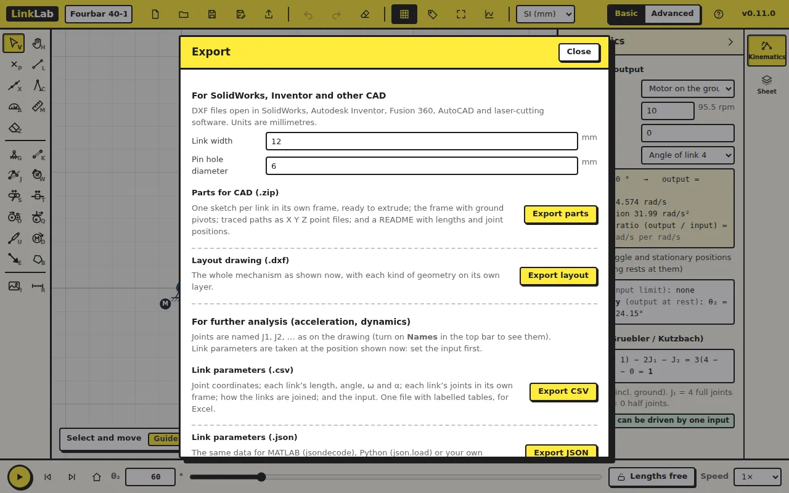

When the design is right, take it out of LinkLab: the links as CAD sketches
to extrude and print, and the numbers for a report.

Start from [fourbar.linklab.json](files/fourbar.linklab.json). Set θ₂ to
60 and click **Export** in the top bar.

## 1. Parts for CAD

**Link width** and **Pin hole diameter** set the shape of every link.
**Export parts** writes a zip with one DXF per link, drawn in the link's
own frame and ready to extrude: `Link2.dxf`, `Link3.dxf`, `Link4.dxf`, a
`Frame.dxf` with the ground pivots, a `Layout.dxf` of the whole mechanism,
the traced path as `Path_P1.txt` (X Y Z points, for a curve in CAD), and a
`README.txt` with the lengths and joint positions.

In SolidWorks or Inventor: new part, new sketch, insert the DXF, extrude.
Everything is in millimetres.

## 2. The layout drawing

**Export layout** writes one DXF of the mechanism as drawn, with each kind
of geometry on its own layer: LINKS, PIN_HOLES, CENTRE_LINES, GROUND, PATHS
and NOTES. Use it for a drawing sheet, or to lay the parts out for laser
cutting.

## 3. The numbers

**Export CSV** writes the link parameters at the position shown, with
labelled tables for a spreadsheet: joint positions, velocities and
accelerations; each link's length, angle, ω and α; masses; and how the
links are joined. Joints are named J1, J2, … as on the drawing (turn on
**Names** in the top bar to see them).

| In the CSV at θ₂ = 60° | |
|---|---|
| Link 2 length | 40 mm |
| Link 4 length | 80 mm |
| J3 (point A) | 20, 34.641 mm |

The coupler is a plate with three joints, so its row has no single length;
its joint-to-joint distances are in the LINK GEOMETRY table.

**Export JSON** gives the same data for MATLAB or Python. **Export data**,
in the plots, gives every plotted quantity over the whole cycle.

## Try this

Open `Link3.dxf` in your CAD program and check the distances between its
three holes: the two pins and the traced coupler point (a hole for a pen,
or for a link added later).

Answer

120 mm between the two pins (the coupler length). The coupler point's
hole is midway between them, 60 mm from each.

